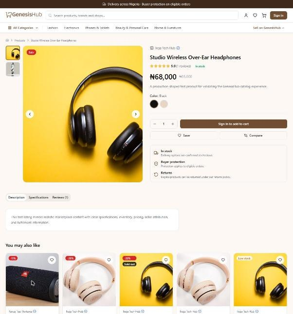

# GenesisHub: rebuilding a multi-vendor marketplace for correctness

**Live demo:** https://genesis-hub-nextjs.vercel.app (development environment, Paystack sandbox)
**Role:** sole engineer: architecture, database, backend, frontend, payments, deployment
**Stack:** Next.js 16 · React 19 · TypeScript · Supabase (PostgreSQL, Auth, Row-Level Security, pg_cron) · Paystack · Vercel · Vitest · GitHub Actions
**Code:** private (available to hiring teams on request). The first version, in Laravel, is public: [github.com/abbey-001/genesisHub](https://github.com/abbey-001/genesisHub)

| Storefront | Product page |
|---|---|
|  |  |

---

## The problem

GenesisHub is a Nigerian marketplace where independent sellers list products, customers pay online, and logistics partners collect from several shops and deliver one bundled order.

I built the first version in Laravel. It worked, but as the feature set grew, reviewing it surfaced structural risks you can't patch around:

- **Two competing checkout paths** and **two rider-assignment systems** had grown side by side.
- **Two external search engines** (Algolia and Typesense) both had to be kept in sync with the catalog.
- **Money was stored as decimals**, and side effects like emails and Telegram alerts ran inside the request, so a provider outage could break checkout.
- **Authorization lived only in application code.**

So I rebuilt it on Next.js and Supabase, keeping the verified business rules and dropping the accidental complexity.

## Key decisions

I wrote the decisions down as architecture decision records before writing the code.

1. **The database is the final security boundary.** Every exposed table has PostgreSQL Row-Level Security. Next.js checks who you are and what you own, and the database enforces the same rule again. Policies are tested for anonymous users, customers, sellers, logistics companies, admins, and access across tenants.
2. **One checkout workflow, chosen on purpose.** I rebuilt the gateway-driven payment flow and removed the older direct-order path. An order is only paid once a *verified* Paystack callback or signed webhook says so.
3. **Money is stored as whole numbers in kobo** (the smallest currency unit), with idempotency keys and an append-only ledger for every financial event.
4. **A transactional outbox for side effects.** Emails, notifications and provider calls are written in the same database transaction as the business change, then delivered by a worker with retries and a dead-letter queue. Checkout never waits on an email provider.
5. **PostgreSQL full-text search instead of two external engines.** Search results are always consistent with the catalog and need no indexer. An external engine can be added later if measurements justify it.
6. **Explicit state machines** for orders, payments, item fulfilment, delivery bundles, refunds and payouts. Transitions run in transactional PostgreSQL functions.

## Hard problems and how they were verified

| Problem | Approach | Evidence |
|---|---|---|
| Overselling under concurrent checkout | Stock is reserved inside the checkout transaction | Two simultaneous checkouts for 3 units in stock: one succeeded, one failed cleanly; inventory never went negative |
| Paystack retries and duplicate events | Payments are finalised idempotently; replay-safe event log | Replaying the callback and sending the same signed webhook twice produced one payment and one stock decrement |
| Forged webhooks | HMAC-SHA512 signature verification | An invalid signature returns `401` and nothing is processed |
| Refunds | Cancellation triggers exactly one provider refund and restores stock | A real sandbox refund stored the provider refund ID and restored stock from 21 to 22 |
| Abandoned payments | Scheduled `pg_cron` job | Unpaid orders expire automatically every five minutes |
| Multi-shop delivery pricing | 360-row pickup-to-destination matrix, deduplication of same-zone pickups, 15% discount for multiple pickups | Pricing verified by script against the original Laravel matrix |
| Payout fraud risk | Two-person approval for payouts, granular admin permissions, audit trail | Covered in the admin finance runbook |

## Scope

- Customer storefront, search, wishlist, compare, reviews, server-side carts across multiple shops, coupons, checkout, order tracking, refunds
- Seller workspace with tenant isolation, catalog management and readiness commands
- Logistics-company workspace: zone-bundle broadcast that exactly one rider can accept, wait-for-all dispatch, private proof of delivery
- Admin: role-based access, finance reconciliation, payouts, reports, runbooks
- About 430 TypeScript source files, 60 versioned SQL migrations, SQL contract tests for each phase, and Vitest unit tests, with checks in GitHub Actions

## What I'd highlight in an interview

- Choosing **database-enforced authorization** over application-only checks, and testing it across tenants.
- Designing for **retries, replays and races** in payments instead of assuming the happy path.
- Treating the rewrite as a **migration**: the legacy system was mapped and reconciled first, and the behaviour that had been verified was preserved.
